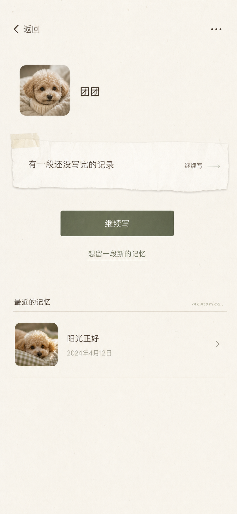

# 宠物记忆：M0 工程骨架与设计系统决策记录

> **视觉方向已确认（2026-07-21）**  
> 空间首页采用下方参考图的第 2 张作为整体视觉方向。它继承的是温暖、低对比的纸张感，克制的照片比例，舒展的纵向留白，以及以细分隔组织的安静列表；不是照搬其中的宠物、文案或装饰。  
> 
>
> 草稿提示暂时可以保留极少量撕纸/胶带的有机纸感；这是 M0 唯一允许使用该细节的位置，不能扩散为每页装饰。M0 继续使用系统字体；不采用英文手写字、字数统计、连续记录、成就指标，或“Ta 还在等你继续”这类替用户表达情感的文案。

版本：v0.3  
日期：2026-07-26  
状态：M0 决策基线与开工前一致性复核已完成；本文不代表代码已经实现，正式实施仍需用户另行授权

阶段：`M0 — 本地 Mock 骨架`。真实身份、CloudBase、云端照片、真实 AI、真实导出与邀请制用户数据属于 `M1 — CloudBase Private Alpha`。

## 1. 文档用途

本文件记录 `M0` 工程骨架与设计系统已经确认的决策，避免依赖聊天上下文。它不是最终实施计划，也不替代以下长期约束：

- [产品核心说明书](../foundation/2026-07-15-pet-memory-core-design.md)
- [正式 MVP 决策书](../mvp/2026-07-20-formal-mvp-decision.md)
- [微信小程序工程决策](../technical/2026-07-20-wechat-miniapp-engineering-decision.md)

文档职责与优先级如下：

1. 产品使命、情绪安全、真实内容优先和默认私密由产品基础文档约束，任何下层文档不得突破；
2. M1 的正式范围由 MVP 决策书约束；
3. 客户端、CloudBase、安全和环境边界由工程决策约束；
4. M0 的页面、状态、数据、视觉与测试细节以本文为直接实现输入。

发现冲突时不得静默选择其中一条；先按上述职责判断，仍无法消解时回到决策文档确认。本文只保留已确认结论和必要理由，不保留聊天过程。实施步骤以 [《M0 工程骨架实施计划》](../plans/2026-07-23-m0-engineering-skeleton-implementation-plan.md) 为准；计划与本文冲突时，必须先修正规则或取得用户确认，不得由实施者自行选择。

## 2. M0 骨架的实施顺序

### 已确认

- M0 先使用可替换的本地 mock 数据，先稳定路由、页面状态、视觉系统和按钮交互；
- CloudBase 接入在后续切片完成，页面不得因接入真实数据而重写；
- mock 数据在当前开发设备本地持久化，重启后仍可继续检查空间、草稿和已留下的记忆；
- 开发模式提供专用的“重置体验数据”工具，不出现在用户界面；
- mock 数据不能被表述或设计成真实云端保存。

## 3. 全局信息架构与导航

### 已确认

M0 不使用底部 Tab Bar，不放“首页 / 记录 / 我的 / 设置”等固定模块导航。采用层级导航：

```text
首次使用：
首次说明与隐私同意
→ 创建 Ta 的空间
→ Ta 的空间首页

再次进入或管理多个空间：
我的记忆空间
→ Ta 的空间首页

进入记录：
Ta 的空间首页
→ 留下一段
→ 选择记录入口
→ 记录、照片、AI 整理或记忆详情
```

- 顶部返回只回到上一级；
- “我的记忆空间”是稳定的回家入口；
- 记录过程中不显示复杂全局导航；
- 页面底部可以承载当前任务按钮，例如“留下这段记忆”“今天先到这里”，但不是全局导航；
- 设置入口放在 Ta 的空间首页右上角 `···`。

## 4. 首次进入与创建 Ta 的空间

### 已确认

首次还没有空间时，先展示说明页，而不是直接出现空表单：

> 给已经离开一段时间的 Ta，留一个可以慢慢回来的记忆空间。

页面说明内容默认私密，并提供《隐私说明》入口。用户点击“开始”后，记录其对基础隐私规则的同意。

创建空间采用极简字段：

- Ta 的名字：必填，可日后修改；
- 一张照片：可选，可跳过、可日后添加；
- 不索取物种、性别、生日、离开日期、离开原因或完整故事。

创建完成后直接进入 Ta 的空间首页，不继续追问。

首次说明页点击“开始”后，直接进入“给 Ta 留一个空间”的创建页，不经过“我的记忆空间”的空状态列表。空状态列表只用于用户删除最后一个空间后，或用户日后主动回到空间列表但尚未拥有空间的情形；首次路径应当开门见山。

首次说明只展示一次。应用 bootstrap 完成后，`hasCompletedOnboarding: false` 才停留在首次说明；为 `true` 时进入“我的记忆空间”。用户点击“开始”时先持久化完成状态，成功后进入创建页；以后即使没有空间或删除最后一个空间，也进入空间列表空状态，不重新显示首次说明。

创建页当场提供“添加一张照片（可选）”入口，方便愿意使用照片建立归属感的用户；该入口为低强调操作。用户不选照片也可直接创建，系统不得将其提示为资料缺失或未完成。创建成功后直接进入 Ta 的空间首页，让用户先看到已经准备好的私人空间与自然可见的“留下一段”主操作；不得弹出教学遮罩、连续追问，或以任何方式催促其立刻记录。

创建空间时，Ta 的名字仅做最小校验：提交前去除首尾空格、不得为空、最多 20 个字符；不限制昵称形式、中英文或物种相关信息。名称为空时，在输入框下以中性文案提示“先写下 Ta 的名字。”，不使用红色、感叹号、“必填项”等工具化报错表达。

创建页选择照片后显示小型圆角预览，并提供低强调的“更换”和“移除”操作；误选可直接修正，移除不需二次确认，之后恢复为“添加一张照片（可选）”。

创建页返回时，若用户已填写名字或选择照片，显示轻提示“这次先不创建了吗？”，提供“继续填写”和“先不创建”。前者回到原表单；后者丢弃本次临时内容，不建立创建空间草稿。未填写任何内容时直接返回。

当前工程与界面的临时产品名称统一为“宠物记忆”。不在 M0 设计 Logo、字标或品牌图形。

## 5. Ta 的空间首页

### 已确认

空间首页是安静的回看场所，而不是功能菜单。它包含：

- Ta 的名字与可选空间照片；
- 有草稿时，“继续写”只放在草稿纸模块内部；
- 没有草稿时，一个明确但不压迫的主动作“留下一段”；
- 有草稿时，草稿纸模块下方仍显示“留下一段新的记忆”主按钮；该较新确认替代此前的低强调文字入口方案；
- 已确认记忆的“最近留下”纵向条状列表；
- 有草稿时显示低强调的“有一段还没写完的记录”，可继续或只查看已有记忆；
- 右上角 `···` 打开极简设置页。

M0 与 M1 均采用**每个空间最多一条进行中的记录草稿**。草稿数据必须以 `spaceId` 保持唯一约束，不建立“全部草稿”页面，也不允许同一空间同时出现第二条记录草稿。

已有草稿时，点击“留下一段新的记忆”主按钮后打开底部面板：

```text
还有一段没有写完

一个空间一次只保留一段草稿。

[ 继续写这段 ]
[ 不保留这段，另起一段 ]
先不动
```

- “继续写这段”关闭面板并进入现有草稿；
- “不保留这段，另起一段”是本次明确确认：删除当前草稿及只属于该草稿的会话级照片引用，然后进入“选择记录入口”；不再叠加第二层确认；
- “先不动”关闭面板并留在空间首页，不改变任何数据；
- 删除范围只包括当前未完成草稿，不影响正式记忆、空间照片或其他空间；
- 不得静默覆盖旧草稿，也不得在后台创建第二条草稿。

首页点击“留下一段”，或有草稿时完成“留下一段新的记忆”的草稿冲突处理后，才进入“今天想从哪里开始？”页面；首页不直接堆叠四个记录入口。

“全部记忆”采用按时间倒序的**时间档案序列**，不使用瀑布流、相册墙、日历或同质厚卡片堆叠：

- 每条记忆按单列纵向滑动，采用低强调日期、内容与细分隔线形成阅读节奏；
- 有照片时显示左侧圆角缩略图与右侧原话摘要；无照片时文字自然占满内容宽度，不补空图；
- 摘要使用用户原话前两行，超出明确截断并显示省略号 `…`；AI 整理版本不作为默认摘要；
- 相邻条目之间保留约 `24–32px` 呼吸留白，分隔线细且低对比；
- 单张缩略图可随原图比例存在轻微高低差，但不形成无规则瀑布流；点击整条进入记忆详情。

## 6. 记录入口与照片路径

### 已确认

“今天想从哪里开始？”提供四个真实入口：

| 入口 | 用户目标 |
|---|---|
| 日常 | 从 Ta 的一个小习惯或常见场景开始 |
| 一张照片 | 从自己的相册选择照片开始 |
| 相遇 | 从第一次见到 Ta 的片段开始 |
| 你们的关系 | 从一句关系描述开始 |

四个入口必须有不同的第一问，不能只是不同名字进入同一页。

四个入口采用单列、说明性卡片，不使用 2×2 功能宫格：

- 标题字号大于说明文字；
- 入口顺序按情绪负担由轻到重：日常、一张照片、相遇、你们的关系；
- 不默认高亮任何入口；
- 卡片表达“可以从这里开始”，而不是抽象功能或任务。

M0 暂定第一问：

| 入口 | 第一问 |
|---|---|
| 日常 | `Ta 平时最喜欢待在哪个地方？` |
| 一张照片 | `看到这张照片时，你最先想起了什么？` |
| 相遇 | `还记得第一次见到 Ta 时，Ta 是什么样子吗？` |
| 你们的关系 | `如果用一句话形容你和 Ta 的关系，会是什么？` |

这些文案以具体、低压力的线索开始；“你们的关系”是相对抽象的入口，仍允许用户立即切换到更轻的开始方式。后续可依据真机体验和测试反馈调整语气。

记录页的“想不起来”打开可随时关闭的底部轻面板，而不是强制跳转新页面：

```text
换一个更轻的开始

从声音开始
从动作开始
从 Ta 常待的地方开始
看看一张照片

今天先到这里
```

- 当前输入内容必须保留；
- 关闭面板即回到原问题；
- 选择新入口只替换当前问题，不重启记录流程；
- “今天先到这里”沿用草稿选择规则；
- 不使用“再想想”“你应该记得”等压力性语言。

文字记录页操作层级固定为：

```text
输入框下：想不起来
底部主按钮：先留下这段记忆
主按钮下：今天先到这里
```

- “先留下这段记忆”在没有输入时为浅色不可点击，输入后成为主按钮；
- “想不起来”属于当前问题的轻分支；
- “今天先到这里”是安全出口，不与保存按钮并列竞争；
- 不显示“下一步”、完成进度或连续追问。

照片路径规则：

```text
选择自己的照片
→ 照片预览
→ 先把这张照片留在这里 / 说说最先想起的事
```

- “只保存照片”是完整使用，不要求回答问题；
- “继续讲述”才进入轻量问题；
- M0 允许真机从相册选择真实照片，用于测试权限、预览、移除和照片不可恢复时的降级体验；
- 用户从相册选出的照片使用会话级临时路径，标记为 `session-only`，不得把临时路径伪装成可跨重启的本地资产；
- 当前会话中，照片可正常完成“只保存照片”或图文记忆路径；应用重启后，临时照片引用失效；
- 图文记忆在照片引用失效后仍保留文字和记忆记录，并以低强调状态说明“这张照片只用于上次预览，没有保存到云端”，不得显示破图；
- 只有临时照片、没有文字的照片记忆仍保留测试记录和上述不可用状态，用于验证 M0 降级；界面不得声称照片仍已保存；
- 完整 mock 样本中的演示照片使用随应用打包的测试资产，可跨重启稳定显示，必须与用户临时选图区分；
- M1 接入私密云存储后，才实现用户照片的真实持久化与跨设备查看。

## 7. 草稿、退出与正式记忆

### 已确认

草稿与已留下记忆必须在数据、页面和用户心智上严格分开：

```text
用户输入但尚未确认
→ 未确认内容
→ 退出时由用户选择是否留为草稿
→ 下次继续 / 这次不保留

用户主动点击“留下这段记忆”
→ 正式记忆片段
→ 出现在“最近留下”中
```

用户在有未确认修改的内容时点击返回、关闭或“今天先到这里”，出现弹窗：

```text
要先把这段留在草稿里吗？

下次回来，可以从这里继续。

[ 这次先不留下 ]    [ 先留在草稿里 ]
```

规则：

- 没有输入内容时，直接离开，不弹窗；
- 已经确认留下正式记忆时，直接离开，不弹窗；
- “先留在草稿里”后，空间首页展示“有一段还没写完的记录”；
- “这次先不留下”后，该未确认内容不成为草稿也不成为正式记忆；
- 不使用“放弃”“丢弃”等制造压力的措辞；
- 未确认 AI 整理稿同样只能是草稿，不能覆盖原话。
- 一次记录只围绕一段记忆；用户主动留下后不自动追问第二题，也不以完成度推动继续；
- 保存后用户自己决定整理、回到空间或再留一段。

## 8. Mock AI 整理

### 已确认

M0 包含完整但受控的 mock AI 整理流程，不接真实模型：

- 呈现整理等待、正常草稿、信息不足、暂时无法整理四种状态；
- 用户可修改草稿、保留原话或不使用整理；
- 对用户临时输入，mock 不编造新的标题、情节或事实；
- mock 仅用于验证 AI 的等待、确认、拒绝、编辑和失败降级体验；
- 后续以 CloudBase 云函数替换 mock 服务，页面接口和用户流程不应重写；
- AI 的具体服务商、模型与密钥在后续 AI 接入决策中确定。

输入阶段不提供 AI 写作、自动续写、补句或范文。用户先保存自己的原话；之后才可在记忆详情中主动选择“整理一下”。AI 允许帮助用户换一个更轻的问题、切换照片、声音、动作或场景等回忆入口，但不替用户生成记忆内容。

AI 整理确认页采用“候选版本”而不是成品交付：

```text
整理后的版本

根据你留下的话整理，仍然可以修改。

[ 可编辑草稿文本 ]

[ 保留这个版本 ]
继续使用原话
```

- 草稿文本可直接编辑；
- M0 不提供“重新生成”作为默认操作；
- “保留这个版本”后，整理稿以独立版本与原话并列保留；
- “继续使用原话”回到详情页，不替换原话；
- 整理失败时提供“再试一次 / 先保留原话”；
- 不展示模型名、人格化头像或“AI 想法”。

AI 的价值仍是待验证假设：M0 与 M1 均不得以“丰富记忆”“帮你写得更动人”等作为功能承诺或按钮文案。AI 只能在用户已表达的事实范围内减少重复、调整顺序、提炼重点并尽量保留语气；它不能补充场景、动作、性格、情绪或不存在的故事。用户只保存原话本身就是完整且成功的使用。

AI 授权规则：首次进入只同意产品基础隐私说明；用户首次主动使用 AI 整理时，单独说明本次会处理哪些内容，并由用户确认。

## 9. 页面范围

### 已确认

M0 采用“路由页面与局部状态分开”的组织方式。路由页面负责稳定的导航层级、数据读取与返回关系；弹窗、底部面板、加载和失败等短生命周期状态留在所属页面或通用组件内，不为它们创建独立路由。

M0 包含以下 13 个概念路由页面：

1. **首次说明**：最小隐私承诺、《隐私说明》入口与“开始”；
2. **我的记忆空间**：空状态与已有空间列表共用同一页面；
3. **创建 Ta 的空间**：名字、可选空间照片与返回保护；
4. **Ta 的空间首页**：最近留下、单条未完成草稿、留下一段与设置入口；
5. **选择记录入口**：日常、照片、相遇与关系；
6. **文字记录**：日常、相遇和关系共用，通过受控入口类型展示不同首问；
7. **照片记录**：系统相册选择后的预览、移除、“只保存 / 继续讲述”分支；
8. **全部记忆**：按时间倒序的时间档案序列；
9. **记忆详情**：原话、照片、可选整理版本与记忆操作入口；
10. **编辑原话**：独立编辑与未保存修改保护；
11. **AI 候选稿**：等待、成功、信息不足、暂时不可用、编辑与确认共用同一页面；
12. **Ta 的空间设置**：名字、空间照片、隐私入口与删除空间；
13. **隐私说明**：集中说明 M0 本地 mock、M1 云端保存、AI 按次授权、删除与未来导出边界。

以下属于非路由局部状态或组件，不单独登记为页面：

- 退出时的草稿选择弹窗；
- 删除单条记忆或整个空间的确认弹窗；
- “想不起来”底部轻面板；
- 全屏照片查看器；
- 开发者面板；
- 加载、空数据、保存中、保存成功、失败、无权限和内容不存在状态。

四个记录入口不拆成四套页面：日常、相遇和关系共用文字记录页；照片使用独立照片记录页。AI 的等待与结果分支也不拆成多个路由页面。具体文件路径、路由参数与数据读取规则在第 8 组工程边界确认后落定。

M0 不实现真实微信登录、CloudBase、真实照片持久化、真实 AI、真实导出、提醒、分享或社区。

## 10. 记忆详情

### 已确认

记忆详情默认以用户原话为中心，不强制用户或系统为记忆生成标题：

- 有照片时，在页面上方展示照片；多张照片遵循本文件的叠放与滑动规则；
- 没有照片时，原话自然上移，不补假图；
- 创建日期是低强调信息；
- 原话以“你留下的话”等明确来源标签展示；
- “整理一下”是保存原话后才出现的可选操作，默认不展示 AI 改写内容；
- 详情底部提供带图标的“编辑原话”和“删除这段记忆”操作；
- 用户确认 AI 草稿后，原话与整理后的版本仍并列、可查看、可编辑，不互相覆盖。

编辑原话使用独立编辑页，不在详情页直接切换为表单：

```text
编辑你留下的话

[ 原话输入区 ]

[ 保存修改 ]
先不改了
```

- “先不改了”替代工具化的“取消”；
- 无修改时点击“先不改了”直接返回详情；
- 有修改时，显示“这次修改先不保存吗？”并提供“继续修改 / 先不保存”；
- 原话修改不自动改写既有 AI 整理版本；必要时，旧整理版本标记为基于之前的原话。

## 11. 隐私与设置

### 已确认

首次说明页在“开始”前展示最小隐私承诺；AI 整理使用独立、按次的授权说明。

设置页只保留基础控制：

- 修改 Ta 的名字；
- 更换或添加空间照片；
- 隐私说明；
- 删除该空间。

删除空间采用一次明确的删除确认。

删除整个空间只放在设置页最底部，并使用一次明确确认：

```text
要删除团团的整个空间吗？

其中的 12 段记忆和 8 张照片都会被移除，之后无法恢复。

[ 先留着 ]    [ 删除这个空间 ]
```

- 数量按实际内容动态显示，只说明范围、不渲染情绪；
- 确认删除后返回“我的记忆空间”列表；
- 若没有其他空间，进入首次空状态说明页；
- 不设置超过一层的额外确认弹窗。

删除单条记忆采用明确、不可逆的确认文案：

```text
要删除这段记忆吗？

这段文字和关联照片会从 Ta 的空间中移除，之后无法恢复。

[ 先留着 ]    [ 删除这段记忆 ]
```

- “先留着”不改变任何内容；
- 最终删除按钮是少数使用低饱和危险提示色的例外；
- 不使用模糊的“确认 / 取消”；
- 删除一段记忆不会影响同一空间的其他内容。

“导出我的记忆”在 M0 不应作为不可用按钮出现。可在隐私说明中以非交互文字说明：M1 数据服务接入后将提供查看、修改、删除与导出能力。

## 12. 视觉系统

### 已确认

视觉母题：**安静的私人档案**，不是社交产品、普通工具页或治疗产品。

- 主背景：暖象牙白纯色，不使用全局纸张颗粒；纸张感由色彩、留白、细线和局部表面层级形成；
- 强调色：低饱和橄榄灰绿，仅用于确认与选中；
- 文字：深灰褐，不用纯黑；
- 容器：细描边、暖白纸张卡片、克制阴影、大量留白；
- M0 与 M1 只做浅色主题；
- 不做亮色渐变、玻璃悬浮、卡通宠物、AI 形象、深色模式或夸张药丸按钮；
- 不把所有内容都塞进圆角卡片，留白本身也是层级。

字体规则：

- M0 只使用系统字体；
- 不打包自定义中文字体，不依赖某一台设备才存在的字体；
- 用字阶、字重、字距、行高与留白建立气质；
- 品牌与字体方案稳定后，才单独评估有商用授权的字体。

精确颜色、字号、间距、圆角、组件和材质参数统一见“设计参数与组件实现基线”，本节不重复维护第二套数值。真机预览后只允许基于实际可读性做小幅校正，不随页面自行增加新尺度。

## 13. 按钮、反馈与状态

### 已确认

按钮层级：

- 主动作：轻而明确；
- 入口选择：说明性卡片，不是营销 CTA；
- 次要操作：低强调；
- 跳过、暂停、查看与安全退出：文字操作或轻按钮；
- 不使用 999px 药丸主按钮，不做明显悬浮感。

统一交互反馈：

- 按下时下沉约 1px、颜色略深，持续约 120–160ms；
- 页面切换使用短淡入或轻微上移，不做弹跳、飞入或大缩放；
- 保存中显示“正在保存”，禁用重复点击；
- 保存成功更新空间首页或列表，并短暂提示“已留下这段记忆”；
- AI 等待使用安静文本状态，不用人格化“AI 正在思考”；
- 错误必须提供“再试一次 / 先保留原话”；
- 只有删除用户内容时使用危险操作确认；未保存修改和草稿退出使用中性选择弹窗，不使用危险色；
- 不使用彩带、庆祝动画、成就徽章、连续天数或完成百分比。

真实数据接入后的失败处理优先保护内容：

```text
这段还没有保存成功。

你写下的话还留在这里，
可以现在再试一次，也可以稍后再试。

[ 再试一次 ]
先回到空间
```

- “再试一次”重试保存；
- “先回到空间”将内容保留为本地草稿；
- 不展示错误码、服务器术语或“提交失败”；
- 照片上传失败时保留文字，照片单独标记“还没有上传成功”；
- AI 整理失败仅提示“暂时无法整理”，不影响原话的保存与查看。

## 14. 照片视觉细节

### 已确认

照片不使用直角：

- 大图使用约 `18px` 圆角；
- 记忆列表缩略图使用约 `12px` 圆角；
- 照片叠放容器可使用约 `22px` 圆角，但每张照片保持约 `18px`；
- 使用极细描边或极轻阴影，不让装饰压过照片内容。

本节的 `约 12px / 18px / 22px` 是视觉方向记录，不是 Builder 可直接使用的工程常量；缩略图 `24rpx` 等精确尺寸、圆角和换算值统一以 [《M0 设计系统工程执行规格》第 8 节](2026-07-24-m0-design-system-engineering-spec.md) 为准。

某条记忆关联 2 张及以上照片时，在**记忆详情页**使用多图叠放：

- 最上层照片保持正向；
- 后方最多露出 1～2 张，以右下角为旋转基点顺时针轻微旋转约 `2°`、`4°`；
- 视觉上最多展示三层；
- 用户左右滑动时，下一张成为最上层，其余照片重新轻微叠放；
- 不自动轮播；
- 右下角低强调显示 `1 / 3` 等数量提示；
- 点击照片进入完整查看；
- 首页“最近留下”不采用叠放，只显示单张缩略图或纯文字条，保持信息清晰。

照片完整查看采用极简全屏查看器：

- 使用暖深灰遮罩聚焦照片，但不代表产品启用深色主题；
- 顶部仅显示“关闭”和低强调的 `1 / 3` 等数量；
- 可左右滑动查看同一段记忆的其他照片；
- 不提供分享、下载、转发、评论或编辑入口；
- 关闭后返回原记忆详情及原滚动位置。

## 15. 开发 mock 数据

### 已确认

开发骨架维护两套内部 mock 数据：

| 样本 | 内容 | 用途 |
|---|---|---|
| 空状态样本 | `hasCompletedOnboarding: false`，没有任何 Ta 的空间 | 验收真正首次进入、隐私说明和创建空间流程 |
| 完整样本 | `hasCompletedOnboarding: true`；团团：有空间照片、两段正式记忆、一段草稿，其中一段有多张照片；豆豆：无空间照片、无正式记忆 | 验收空间列表、草稿续写、最近留下、空空间与多图详情 |

- 用户首次体验默认使用空状态，不出现虚构示例宠物；
- 完整样本只能通过开发者重置工具启用，用于内部验收；
- “已完成首次说明但没有空间”通过空样本点击“开始”、在创建页取消后进入 02 复现，不新增第三套样本；
- 两套样本足以覆盖 M0 状态，不额外堆砌假数据。

## 16. 身份与登录时机

### 已确认

M0 不出现微信登录或任何账户门槛。用户应能直接完成首次说明、创建 Ta 的空间、留下与回看本机 mock 记忆；这既避免登录阻断体验验收，也避免开发期被 AppID、授权与测试账号配置牵制。

真实 CloudBase 接入后采用**延迟、无感身份建立**：不在首次打开或创建空间时展示登录页、索取头像昵称，或要求用户完成传统账户授权。当用户第一次执行真实云端写入（例如保存首个 Ta 的空间）时，云函数静默识别微信身份并建立数据归属；页面只继续完成原本的保存反馈。前端必须以可替换的匿名本地会话接口工作，不能把页面逻辑绑定到可见登录态。

## 17. M0 Mock 服务与开发工具

### 已确认：Mock AI 服务采用固定状态服务

M0 的 `MockAiDraftService` 不根据用户临时输入动态编造内容，而是通过受控场景稳定返回三类结果：

```ts
type AiMockScenario =
  | 'success'
  | 'insufficient'
  | 'unavailable'

interface AiDraftService {
  createDraft(input: CreateAiDraftInput): Promise<AiDraftResult>
}
```

- `success` 返回固定、可追溯的候选稿；
- `insufficient` 呈现信息不足状态；
- `unavailable` 呈现暂时无法整理状态；
- 服务支持约 `600–900ms` 的固定等待、重复请求锁与开发者场景切换；
- 原话永远不可被 mock 结果覆盖；
- 后续接入真实 AI 时只替换 service 实现，页面状态与交互不重写。

选择固定状态服务，是为了先验证等待、编辑、确认、拒绝和失败降级等交互契约，不在 mock 阶段假装验证模型质量。

### 已确认：开发者工具采用隐藏但可发现的入口

仅在开发构建中提供内部开发面板，支持：

- 切换 `empty / complete` 样本；
- 重置本地体验数据；
- 切换 AI mock 场景；
- 模拟保存失败、图片失败与权限不足；
- 查看当前路由、空间 ID 与数据版本。

入口由 `DEV` 环境标志或条件编译保护，生产构建中移除入口和调试信息。它不成为正式路由，也不出现在普通用户界面中。

## 18. 空间、记录、照片与数据控制补充规则

### 空间与回看

- “我的记忆空间”按最近新增或更新的正式记忆排序，不按最近查看排序；
- 空间卡显示可选照片、Ta 的名字、最新用户原话前两行（超出显示 `…`）与日期；无正式记忆时显示“还没有留下记忆”；
- Ta 的空间首页仅展示最近 3 条正式记忆，并通过低强调“查看全部记忆”进入完整列表；
- 多空间时，列表末尾使用低强调文字入口“给另一位 Ta 留一个空间”；
- M0 与 M1 不做搜索、筛选或标签。

### 记录与照片

- 四个记录入口均只提供一个首问；M0 与 M1 不自动连续追问；
- 不显示字数统计；实现层可设置 2,000 字的宽松上限，仅在超过时提示；
- 日常、相遇和关系入口的文字记录保存前可选“加一张照片”，不是必经步骤；记忆默认记录创建日期，不要求填写事件发生日期；
- 单条记忆在 M0 与 M1 最多关联 9 张照片，按用户选择顺序显示，可移除，不做拖拽排序；
- 空间照片和记忆照片独立：删除或更换空间封面不影响记忆照片；M0 与 M1 仅居中裁切并使用 `object-fit: cover`，不提供图片编辑器。

### AI、设置与数据控制

- AI 入口文案为“整理一下”，不用“润色”“丰富”或“帮我写”；首次使用时明确说明仅处理当次选定原话、生成可编辑候选版本且绝不覆盖原话；
- M0 与 M1 每次仅生成一个候选稿，不提供“重新生成”；
- 真实 AI 接入时，提示词、严格约束及输出过滤机制由后续专门的调试与安全规格确定。当前仅保留原则：云函数应检查输出长度、事实越界风险、拟人化表达与过度煽情；异常或不符合约束时仅保留原话；
- 空间名称修改后，历史页面使用最新空间名称展示，但绝不改写历史原话；
- 删除单条记忆时一并删除仅属于该记忆的关联照片；M0 与 M1 不支持照片跨记忆复用；
- 隐私说明要明确默认私密、本地 mock 与云端真实保存的区别、AI 按次授权与删除不可恢复；M0 不放不可用的导出按钮，真实导出随 M1 CloudBase 数据能力接入后实现。

## 19. M0 状态、Repository 与路由边界

### 19.1 状态管理

M0 使用 Pinia，但只建立两个全局 Store：

```text
useAppStore
├─ bootstrapStatus
├─ sampleMode
├─ schemaVersion
├─ hasCompletedOnboarding
└─ devMode

useMemoryStore
├─ spaces
├─ memories
├─ drafts
├─ assets
└─ 领域读取与写入 actions
```

`useAppStore` 只负责应用初始化、`empty / complete` 样本模式、数据版本、首次说明完成状态和开发模式。`useMemoryStore` 负责空间、正式记忆、每空间一条进行中草稿、资产索引，以及调用 Repository 的业务动作。不得把领域内容复制到两个 Store。

弹窗是否打开、保存中、当前输入、当前错误和底部面板等短生命周期 UI 状态使用页面内的 `ref / reactive` 管理，不建立 `useUiStore`。页面卸载时这些状态自然释放，避免跨页面残留。只有确实需要跨路由保持的业务内容才能进入 `useMemoryStore`。

Store 不直接调用 `uni.getStorage`、`uni.setStorage`、CloudBase SDK 或模型接口；组件也不得直接读取 Store，除非该组件明确是页面级容器。普通展示组件通过 props 接收数据，通过事件返回用户选择。

### 19.2 Repository 与本地快照

页面通过 Store action 使用稳定的 `MemoryRepository`，M0 由 `LocalMemoryRepository` 实现：

```text
页面
→ Pinia action
→ MemoryRepository
→ LocalMemoryRepository
→ uni storage

M1 替换为：
→ CloudBaseMemoryRepository
```

首批接口至少包含：

```ts
interface NewSessionAssetInput {
  uri: string
}

type MemoryAssetInput =
  | { kind: 'existing'; assetId: string }
  | { kind: 'new'; asset: NewSessionAssetInput }

interface CreateSpaceInput {
  name: string
  coverPhoto: NewSessionAssetInput | null
}

interface UpdateSpaceInput {
  spaceId: string
  name: string
  coverPhotoChange:
    | { kind: 'keep' }
    | { kind: 'remove' }
    | { kind: 'replace'; photo: NewSessionAssetInput }
}

interface SaveMemoryInput {
  spaceId: string
  entry: RecordEntry
  originalText: string
  assets: MemoryAssetInput[]
  sourceDraftId: string | null
}

type UpdateMemoryInput =
  | { kind: 'original-text'; memoryId: string; originalText: string }
  | { kind: 'ai-candidate'; memoryId: string; aiCandidateText: string | null }

interface SaveDraftInput {
  spaceId: string
  entry: RecordEntry
  text: string
  assets: MemoryAssetInput[]
}

interface RepositoryWriteResult<T> {
  value: T
  snapshot: MemorySnapshot
}

interface MemoryRepository {
  bootstrap(): Promise<MemorySnapshot>
  completeOnboarding(): Promise<MemorySnapshot>

  createSpace(input: CreateSpaceInput): Promise<RepositoryWriteResult<MemorySpace>>
  updateSpace(input: UpdateSpaceInput): Promise<RepositoryWriteResult<MemorySpace>>
  deleteSpace(spaceId: string): Promise<MemorySnapshot>

  saveMemory(input: SaveMemoryInput): Promise<RepositoryWriteResult<MemoryItem>>
  updateMemory(input: UpdateMemoryInput): Promise<RepositoryWriteResult<MemoryItem>>
  deleteMemory(memoryId: string): Promise<MemorySnapshot>

  saveDraft(input: SaveDraftInput): Promise<RepositoryWriteResult<MemoryDraft>>
  deleteDraft(draftId: string): Promise<MemorySnapshot>

  resetSample(mode: SampleMode): Promise<MemorySnapshot>
}
```

输入合同同时遵守：

- 页面和 Store 不传实体 ID、`createdAt`、`updatedAt`、资产归属或 `availability`；这些字段由 Repository 使用注入的 ID 与时钟生成；
- `NewSessionAssetInput` 只表示本机当次选择的临时照片，Repository 固定创建为 `session-only`，调用方不能伪装为 `bundled`；
- `MemoryAssetInput.existing` 只接受已经属于当前空间或来源草稿的资产，Repository 必须校验所有权和顺序；
- `SaveDraftInput` 以 `spaceId` 执行单草稿 upsert，不允许调用方创建第二条草稿；
- `SaveMemoryInput` 至少包含非空原话或一张照片，照片总数不得超过 9；
- `UpdateMemoryInput` 只允许修改原话或 AI 候选稿；M0 不通过该接口编辑既有记忆照片；
- 所有写操作返回成功后的完整 `MemorySnapshot`，Store 直接使用该快照整体更新，不在页面层手工拼接部分实体。

从已有草稿保存为正式记忆时，`saveMemory` 必须在一次版本化快照写入中同时完成：

```text
创建正式记忆
→ 将本次资产归属从草稿更新为正式记忆
→ 删除来源草稿
→ 校验该空间仍然最多一条草稿
→ 写入完整新快照
```

任一步骤失败都不得提交部分结果。Store 只在 Repository 返回成功后整体替换状态；不得先成功创建正式记忆，再用第二次独立写入删除草稿。

M0 使用一个版本化快照键 `pet-memory:m0:snapshot`，不把业务数据拆成多个互不一致的 Storage 键：

```ts
interface MemorySnapshot {
  schemaVersion: 1
  sampleMode: 'empty' | 'complete'
  hasCompletedOnboarding: boolean
  spaces: MemorySpace[]
  memories: MemoryItem[]
  drafts: MemoryDraft[]
  assets: LocalAsset[]
}
```

- `bootstrap()` 负责读取、校验和迁移快照；无法识别的未来版本不得被当前程序静默覆盖；
- `hasCompletedOnboarding` 只表示用户是否已离开首次说明。用户点击 01 的“开始”时先通过 Repository 原子写入 `true`，成功后才进入 03；查看隐私说明不改变它；
- `completeOnboarding()` 写入超过 `150ms` 时主按钮显示“正在准备…”；失败时停留 01 并显示“刚才没有准备好，可以再试一次。”，不得先导航再补写；
- M0 发布前继续收口在 `schemaVersion: 1`。旧 v1 快照缺少该字段时：已有空间归一化为 `true`，无空间归一化为 `false`；发现已有空间但字段为 `false` 时必须保留数据并修正为 `true`；
- `resetSample('empty')` 固定恢复 `hasCompletedOnboarding: false`；`resetSample('complete')` 固定为 `true`；
- 每个 `spaceId` 最多存在一条进行中的记录草稿；Repository 写入时再次校验，不只依赖页面限制；
- 页面保留当前输入，Repository 写入成功后 Store 才提交正式状态并导航；失败时页面输入仍在，Store 不伪装保存成功；
- `sampleMode` 只用于开发数据选择，不成为用户业务字段；
- UI 临时状态、弹窗状态、loading 和 Toast 不进入快照；
- 用户相册临时路径仅作为 `session-only` 资产存在，生命周期遵循照片路径章节；打包样本资产可稳定恢复；
- M1 可以拆分云端集合，但必须继续满足此接口的业务语义，页面不得感知具体集合或 SDK。

### 19.3 路由、参数与页面读取

M0 使用以下实际页面路径：

```text
/pages/onboarding/index
/pages/spaces/index
/pages/space-create/index
/pages/space-home/index
/pages/record-entry/index
/pages/record-text/index
/pages/record-photo/index
/pages/memories/index
/pages/memory-detail/index
/pages/memory-edit/index
/pages/ai-draft/index
/pages/space-settings/index
/pages/privacy/index
```

路由只传内部 ID 和白名单流程参数：

```text
/pages/space-home/index?spaceId=space_xxx
/pages/record-entry/index?spaceId=space_xxx
/pages/record-text/index?spaceId=space_xxx&entry=daily
/pages/record-text/index?spaceId=space_xxx&entry=photo
/pages/record-photo/index?spaceId=space_xxx
/pages/memories/index?spaceId=space_xxx
/pages/memory-detail/index?memoryId=memory_xxx
/pages/memory-edit/index?memoryId=memory_xxx
/pages/ai-draft/index?memoryId=memory_xxx
/pages/space-settings/index?spaceId=space_xxx
```

`entry=photo` 只表示用户从照片路径继续补充原话。已选择照片必须从 Store 中按当前草稿读取，不得把照片路径或完整对象放入路由。

```ts
type RecordEntry =
  | 'daily'
  | 'photo'
  | 'meeting'
  | 'relationship'
```

- 不得在路由中传 Ta 的名字、用户原话、照片路径或序列化对象；
- `onLoad` 先校验必需参数和 `entry` 白名单，再通过 Store / Repository 按 ID 读取最新数据；
- 文字记录页类型上接受 `daily / photo / meeting / relationship`；其中 `photo` 只能由独立照片记录页的“继续讲述”进入，不能作为首页或记录入口页的直接入口；
- 缺少必需参数时返回合理上级页面并显示轻提示，不白屏、不显示技术错误；
- ID 格式有效但内容不存在时，页面显示“这段内容已经不在这里”，提供返回空间或空间列表的明确操作；
- 保存成功后先更新 Store，再按第 19.4 节执行栈归一化；目标页面从 Store 读取最新摘要、草稿状态和排序，不保留旧对象副本；
- 页面不得仅因为内存中暂时没有对象就判断内容不存在；必须等待 `bootstrap` 完成。

### 19.4 导航、返回与页面栈合同

导航必须符合用户对“我刚才从哪里来、完成后应该去哪里”的理解。实现不得依赖连续多次 `navigateBack` 猜测历史栈；跨越临时流程的成功、删除和放弃操作必须显式归一化到稳定页面。

#### 全局返回规则

- 返回动作优先关闭当前最上层的键盘、照片查看器、底部面板或确认弹窗；只有没有局部覆盖层时才离开路由页面；
- 有未保存文字、照片或资料修改的表单，离开前必须触发对应的保留、继续或放弃保护；无修改时直接返回逻辑来源；
- 创建、正式保存和删除成功后，已经完成或已经失效的表单页不得残留在返回栈中；
- 页面不得要求用户连续返回多个已经完成的步骤才能回到空间首页；
- 详情页、隐私页等可能存在多个来源的页面，以实际进入来源决定返回目标；不得用私人内容或完整对象记录来源；
- 长列表进入详情再返回时，恢复原列表的滚动位置；
- 系统返回手势、页面返回按钮和成功后的程序化导航必须遵守同一合同。

#### 13 页导航矩阵

| 当前页面 | 进入下一步 | 返回或完成后的稳定目标 |
|---|---|---|
| 01 首次说明 | 隐私说明进入 13；开始进入 03 | 从 13 返回 01；完成首次创建后不再回到 01 |
| 02 我的记忆空间 | 创建进入 03；选择空间进入 04 | 根页面系统返回退出小程序 |
| 03 创建空间 | 创建成功进入新空间的 04 | 取消或确认放弃返回 02；成功后栈归一化为 `02 → 04` |
| 04 空间首页 | 设置进入 12；留下一段进入 05；草稿继续进入 06 或 07；记忆进入 09；查看全部进入 08 | 返回 02 |
| 05 记录入口 | 日常、相遇、关系进入 06；照片进入 07 | 返回 04；不得回到已经结束的记录流程 |
| 06 文字记录 | 可从 05 或 07 进入 | 正式保存进入新记忆 09，栈归一化为 `04 → 09`；保存草稿或确认放弃返回 04；从 07 进入且无新增内容时返回 07 |
| 07 照片记录 | 继续讲述进入带 `entry=photo` 的 06 | 只保存照片进入新记忆 09，栈归一化为 `04 → 09`；无未保存内容时返回 05；确认保存草稿或放弃返回 04 |
| 08 全部记忆 | 选择记忆进入 09 | 返回 04，并恢复滚动位置 |
| 09 记忆详情 | 编辑进入 10；AI 整理进入 11 | 普通返回实际来源 04 或 08；新建成功后进入的详情返回 04；删除成功返回实际来源并刷新 |
| 10 编辑原话 | 保存修改 | 保存或无修改取消返回 09；有未保存修改时先保护 |
| 11 AI 候选稿 | 使用候选稿或继续使用原话 | 两种完成动作均返回 09；候选稿有未保存编辑时先保护 |
| 12 空间设置 | 隐私说明进入 13 | 保存资料后留在 12 并显示成功反馈；返回 04；删除空间成功后清理失效栈并进入 02 |
| 13 隐私说明 | 无下级页面 | 返回实际来源 01 或 12 |

草稿恢复目标由草稿内容决定：

- 照片入口且只有照片、没有原话时恢复到 07；
- 已进入文字讲述或任一文字入口时恢复到 06；
- 恢复只读取 Store 中的草稿和资产，不把内容塞进路由。

删除记忆时，如果详情来自 08，删除成功返回 08；如果来自 04 或新建成功路径，返回 04。目标列表或首页必须从更新后的 Store 读取，不显示已删除条目。

导航适配器至少提供以下固定能力；页面不得直接散落组合 `redirectTo / reLaunch / navigateBack` 来制造不同栈语义：

```ts
export type StableDestination =
  | { page: 'spaces' }
  | { page: 'space-home'; spaceId: string }
  | { page: 'memory-detail'; memoryId: string }

export interface NavigationAdapter {
  push(url: string): Promise<void>
  back(): Promise<void>
  replace(url: string): Promise<void>
  resetTo(destination: StableDestination): Promise<void>
}
```

`resetTo` 只用于创建、正式保存、删除和明确放弃流程后的稳定栈归一化。普通页面前进仍使用 `push`，普通返回仍使用 `back`。

## 20. 设计系统工程规格

本节原有的 `375px` 测量基准、设计令牌、组件尺寸和胶带 CSS 已被后续视觉基准与用户最终确认替代，不得继续作为实施依据。

M0 的视觉真源、`393 × 852 CSS px` 测量坐标和重新确认的全局设计令牌，以 [《M0 设计系统工程执行规格》](2026-07-24-m0-design-system-engineering-spec.md) 为唯一工程真源。

该独立规格已经完成视觉真源、设计令牌、布局算法、组件合同、状态矩阵、照片展示、草稿材质、逐页装配和视觉回归验收的逐项确认。Task 2 实施必须以该规格为唯一工程真源，并等待用户依据实施计划另行授权开工。

## 21. M0 测试与验收策略

M0 采用“轻量自动化覆盖业务规则，微信模拟器和真机验证真实体验”的分层策略，不以覆盖率数字作为交付目标。

### 21.1 类型检查与单元测试

CLI 工程必须提供可重复执行的 TypeScript 类型检查和 Vitest 命令。单元测试优先覆盖：

- `LocalMemoryRepository` 的 bootstrap、读写、失败与重置；
- `schemaVersion` 识别和受支持的快照迁移；
- 每个空间最多一条进行中草稿；
- 空间按最近新增或更新的正式记忆排序；
- 原话两行摘要和省略号规则；
- 删除空间、记忆、草稿与关联资产的范围；
- 路由参数、`entry` 白名单与内容不存在判断；
- `MockAiDraftService` 的 `success / insufficient / unavailable`；
- `useAppStore` 和 `useMemoryStore` 的关键 actions。

Store 测试使用独立 Pinia 实例，测试之间不得共享状态。Repository 测试使用内存化 Storage 适配器或受控 mock，不依赖真实微信环境。

### 21.2 组件测试

只为具有复用行为或状态分支的组件建立组件测试：

```text
PrimaryButton
DraftNotice
ConfirmDialog
MemoryEntry
```

重点验证 disabled/loading 防重复触发、事件载荷、摘要和草稿视觉降级。不为纯静态排版组件追求形式化覆盖率；视觉质量仍通过真实页面截图和真机检查判断。

组件测试采用 Vitest、`@vue/test-utils` 与 `@pinia/testing`；若某个组件依赖微信专属能力，则把平台调用封装为 adapter 并在组件测试中替换，不在 Node 测试环境伪造完整微信运行时。

### 21.3 关键流程自动化

核心页面稳定后，再使用 uni-app 自动化能力覆盖少量高价值闭环：

```text
创建空间
→ 保存一段原话
→ 返回空间回看

输入内容
→ 退出并保留草稿
→ 继续草稿

删除一段记忆
→ 返回列表并更新摘要
```

自动化不得替代相册权限、系统键盘、返回手势和真实设备滚动检查。若自动化插件与当前 Vue 3 CLI 版本或微信开发者工具不兼容，不得为追求自动化而更换核心技术栈；保留单元测试并把该流程纳入场景验收矩阵。

### 21.4 模拟器与真机

每个可验收切片先通过类型检查、单元测试和构建，再进入微信开发者工具。M0 至少在一台 iPhone 和一台 Android 上检查：

- 键盘顶起、输入焦点和长文本；
- 顶部与底部安全区；
- 页面滚动与返回手势；
- 相册授权、拒绝、重新选择与临时路径失效；
- 保存中防重复点击和失败后内容保留；
- 字号、对比度、胶带降级与多图滑动。

测试命令、Node、Vite、Vitest、Pinia 和 uni-app 的精确版本在创建脚手架时根据兼容矩阵锁定，并写入 lockfile；实施计划不得预先臆造尚未安装的版本号。

## 22. M1 CloudBase、验收与私密测试

### 已确认：CloudBase 按能力切片接入

真实云端能力按以下顺序逐步替换 mock：

```text
空间与文字记忆
→ 草稿
→ 私密照片
→ AI 整理
→ 删除与导出
```

每个切片必须经过接口定义、云函数实现、权限验证、前端替换、模拟器验收与真机验收后，才进入下一切片。不得一次性接入全部能力，以免权限、上传、AI 与删除问题相互混杂。

### 已确认：真机采用场景验收矩阵

验收以真实用户任务为单位，至少覆盖：创建空间、留下记忆、退出并保留草稿、继续草稿、保存并回看、选择照片、删除记忆与失败恢复。每个场景记录前置数据、操作步骤、预期页面、预期文案、数据变化、错误恢复方式，以及 iPhone 与 Android 的结果。

自由探索可以作为补充，但不能替代场景矩阵；自动化回归测试在核心路径稳定后逐步增加，首轮不以自动化取代真机体验验收。

### 已确认：邀请制小规模私密测试

第一轮建议邀请 `5–8` 位参与者，使用 `staging` 环境，不使用生产数据。参与者可以使用虚构宠物或测试照片，不要求提交真实隐私内容；任何录音、录屏或访谈记录都必须单独征得同意，并去除姓名与可识别信息。用户可以随时停止测试。

测试采用“任务引导 + 自然操作观察 + 测试后访谈”，主持人提供任务，不解释按钮含义或正确路径，避免测到的是主持人的指导能力。核心任务包括：

```text
理解产品用途
→ 创建空间
→ 留下一段或只保存照片
→ 退出并继续草稿
→ 回看已留下内容
→ 理解原话、AI 候选稿与隐私控制
```

重点观察六个维度：

1. **产品理解**：用户能否自己说出这是一个为 Ta 留下私密记忆的空间；是否误解为普通相册、宠物社区、健康档案或 AI 自动写故事工具。
2. **首次路径**：是否能理解“开始”、创建字段、照片可选与创建完成；是否认为创建后必须马上记录。
3. **空间与记录**：是否理解“留下一段”、四个入口是不同的开始方式而非必须完成的模块；是否能找到“想不起来”和安全退出。
4. **草稿与 AI**：是否知道草稿不是正式记忆；是否理解原话优先、AI 可选、候选稿可编辑且不会覆盖原话；是否担心 AI 编造或认为不使用 AI 就不算完成。
5. **尊重感**：是否感到被催促、被审问或被产品替代表达；是否能自然暂停、离开并在之后继续。
6. **隐私与控制权**：是否理解默认私密、AI 本次处理范围、删除入口与删除不可恢复。

记录应保留用户原话、卡住的位置、误解的按钮或文案、主动提出的问题、情绪和节奏变化，以及未使用的功能。不要把所有反馈直接转化为功能需求，应区分理解问题、交互问题、信任问题与价值问题。

测试后访谈围绕具体行为与感受展开：产品是做什么的、它和相册/日记有什么不同、哪一步自然或有压力、是否理解照片可选与内容可暂停、是否理解原话与 AI 候选稿的关系、是否担心 AI 编造、最担心哪类隐私问题、是否知道如何删除，以及有没有让用户感到被尊重或想退出的时刻。

反馈按“原始观察 → 分类 → 严重程度 → 修改决定”处理：`P0` 为无法理解产品、无法保存或隐私严重误解；`P1` 为核心路径卡住、草稿/删除规则误解或 AI 边界不清；`P2` 为文案、间距、按钮位置或视觉细节；`P3` 为个人偏好或暂时没有证据支持的新功能。只有反复出现，或明显影响信任与核心路径的问题，才进入正式产品规则。

本轮测试的成功标准不是所有用户完成全部流程，而是用户能理解产品用途、独立创建与回看、理解原话优先与隐私控制，并且没有明显感到被催促或被替代表达。

## 23. 已推迟到后续阶段的事项

以下事项不阻塞 M0 实施计划，也不得由实施者自行补入 M0：

- M1 真实 AI 的服务商、模型、提示词、输出过滤和安全回归样本；
- CloudBase 实际环境 ID、微信小程序 AppID、生产密钥和部署资源；
- M1 导出的文件格式、账户注销、草稿保留期限和删除后台执行细节；
- 实际发布地区适用的隐私、个人信息与平台合规核对；
- M2 的提醒、分享、纪念卡片、生图、语音和商业化能力；
- 品牌正式名称、Logo、自定义字体和深色主题。

新增上述能力必须重新经过“方案比较 → 用户确认 → 决策落档 → 实施计划”的流程。
