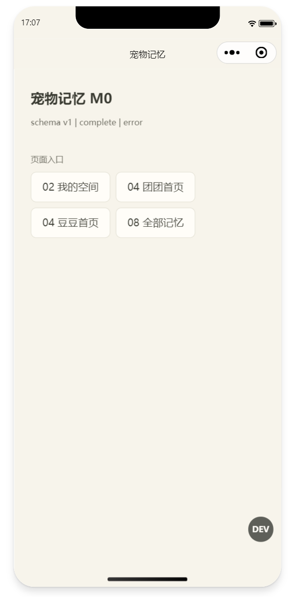
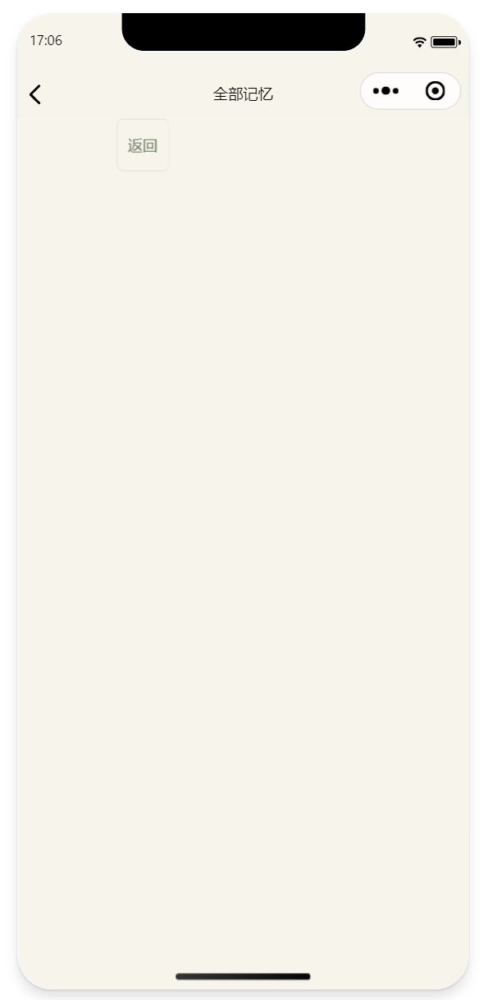
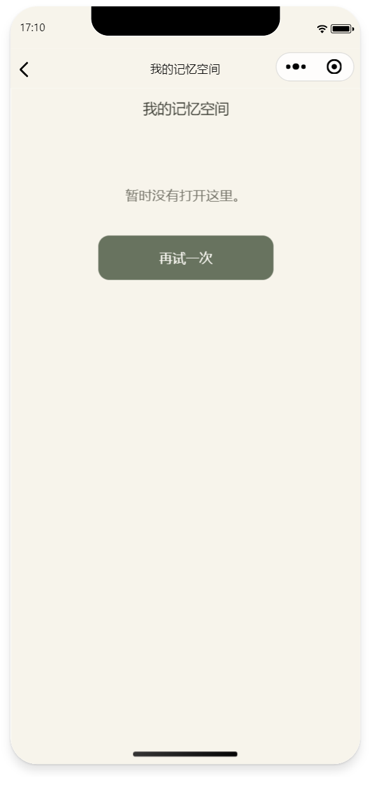
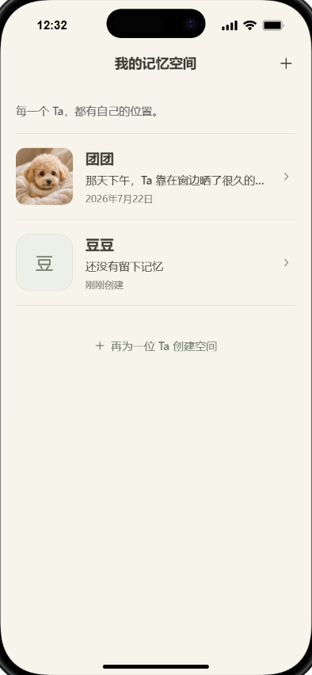
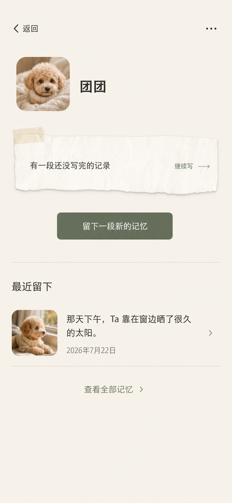
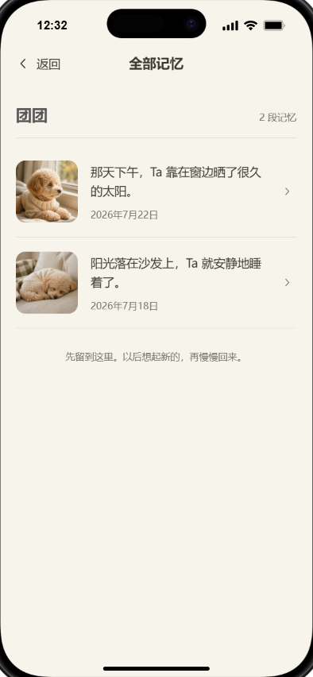

# Task 5A 页面回看基础独立 Review 结果与修复指导

日期：2026-07-29  
审查范围：Task 5A，页面 02、04、08，以及本轮验收所依赖的 DEV 入口、应用初始化、PageShell 和微信 WXSS 产物  
当前状态：`needs-fix`  
是否允许进入 Task 5B：否  
报告用途：指导 Builder 修复，并为无视觉能力 Reviewer 提供可机械执行的复核步骤

## 1. 最终结论

Task 5A 当前不能标记为 `reviewer-accepted`。

本轮确认：

- 领域视图模型、页面状态测试、类型检查和 CLI 微信构建大部分能够运行；
- `npm run verify:task5a` 退出码为 `0`；
- 20 个测试文件、512 项测试通过；
- TypeScript 类型检查通过；
- `uni build -p mp-weixin` 完成；
- 02、04、08 的构建文件存在。

但是，以上自动结果不能证明 Task 5A 已完成。微信开发者工具的真实预览暴露了以下阻断问题：

1. 组件 WXSS 含微信不允许的标签选择器，构建检查错误地报告通过；
2. DEV 完整样本已经写入，但应用仍处于 `bootstrapStatus=error`；
3. 四个 DEV 页面入口没有先准备可验收状态，跳转后只能看到错误页或空壳；
4. 原生导航栏与 PageShell 自绘导航同时存在，产生双标题和双返回；
5. 04“留下一段”跳到了错误的创建空间路由，测试也在保护错误实现；
6. 02、04、08 的源码结构与正式视觉基准存在明显结构性差异；
7. 仓库没有提交本轮要求的三张实现截图及视觉比较证据；
8. Task 5A 验证脚本没有覆盖上述真实失败路径。

因此当前状态应从：

```text
self-verified
```

退回：

```text
needs-fix
```

在本报告第 12 节退出条件全部满足前，不得开始 Task 5B 正式施工，也不得更新 README 或实施计划为 Task 5A 已通过。

## 2. 审查依据

本轮使用以下正式真源：

- [Task 5A 构建及验收标准](../acceptance/2026-07-28-task-5a-space-browsing-acceptance-standard.md)
- [M0 工程骨架实施计划](../../product/plans/2026-07-23-m0-engineering-skeleton-implementation-plan.md)
- [M0 工程骨架与设计系统决策](../../product/specs/2026-07-21-initial-engineering-skeleton-and-design-system-decisions.md)
- [M0 设计系统工程执行规格](../../product/specs/2026-07-24-m0-design-system-engineering-spec.md)
- [M0 页面视觉基准说明](../../product/assets/m0-page-baselines/README.md)
- [02 我的记忆空间视觉基准](../../product/assets/m0-page-baselines/02-spaces.png)
- [04 Ta 的空间首页视觉母版](../../product/assets/m0-page-baselines/04-space-home.png)
- [08 全部记忆视觉基准](../../product/assets/m0-page-baselines/08-memories.png)

本报告不新增产品范围，不改变已确认的页面流程，也不授权重构 Task 2–4。所有推荐方案均用于恢复已经确认的合同。

## 3. 微信现场证据

### 3.1 DEV 验收入口



截图可机械读取的信息：

```text
schema v1 | complete | error
```

页面同时出现四个入口：

```text
02 我的空间
04 团团首页
04 豆豆首页
08 全部记忆
```

结论：

- Repository 的完整样本重置已经至少部分成功；
- App Store 仍保留初始化错误状态；
- 数据状态和应用状态不同步；
- 四个入口只是直接导航，没有保证目标页面进入 `ready`；
- 当前 DEV 页面不能作为稳定验收宿主。

### 3.2 08 全部记忆空壳



截图可机械读取的信息：

- 微信原生导航栏显示“全部记忆”；
- 左上角存在微信原生返回；
- PageShell 又渲染了一个“返回”操作；
- 页面没有空间名称、记忆数量或两条正式记忆；
- 页面没有显示正式 error、missing 或 empty 说明。

结论：

- 原生导航与 PageShell 导航重复；
- 页面在 `bootstrapStatus !== ready` 时只留下空壳；
- 该截图不能作为 08 的正式视觉证据。

### 3.3 02 我的记忆空间错误状态



截图可机械读取的信息：

- 微信原生导航栏显示“我的记忆空间”；
- PageShell 内容区再次显示“我的记忆空间”；
- 根页面出现原生返回箭头；
- 页面正文是“暂时没有打开这里。”；
- 页面只有“再试一次”；
- 完整样本中的团团、豆豆都没有出现。

结论：

- 02 没有进入完整样本状态；
- 02 根页面导航合同被破坏；
- 双标题和根页面返回均不符合视觉与导航合同；
- 该截图不能作为 02 的正式视觉证据。

### 3.4 缺失证据

本轮没有取得可接受的 04 完整样本截图。

仓库也没有找到以下 Task 5A 实现证据：

```text
02-spaces 实现截图
04-space-home 实现截图
08-memories 实现截图
三页并排图
三页 50% 叠层图
三页差异图
三页 P0–P3 结论
```

仓库中的三张正式基准图不是实现截图，不能代替微信开发者工具的真实产物证据。

## 4. 问题总表

| ID | 优先级 | 状态 | 问题 | 主要影响 |
|---|---|---|---|---|
| `R5A-01` | P1 | 已确认 | `uni.scss` 向组件注入 `page.data-v-*` | 微信组件 WXSS 警告，真实预览不干净 |
| `R5A-02` | P1 | 已确认 | WXSS 检查器漏检组件标签、ID、属性选择器 | CLI 构建产生假绿 |
| `R5A-03` | P1 | 已确认 | reset complete 后 App Store 仍为 error | DEV 样本与页面状态不一致 |
| `R5A-04` | P1 | 待取得初始错误文本 | 首次 bootstrap 失败根因没有暴露 | 无法可靠修复首次启动 |
| `R5A-05` | P1 | 已确认 | 四个 DEV 入口直接导航 | 02/04/08 无法稳定验收 |
| `R5A-06` | P1 | 已确认 | 原生导航和 PageShell 同时渲染 | 双标题、双返回、安全区错误 |
| `R5A-07` | P1 | 已确认 | PageShell 平台 CSS 变量没有真实接线 | 状态栏、胶囊和安全区只能使用 0 默认值 |
| `R5A-08` | P1 | 已确认 | 04“留下一段”进入 `space-create` | 核心导航合同错误 |
| `R5A-09` | P1 | 已确认 | 对应测试断言错误路由 | 测试保护错误实现 |
| `R5A-10` | P1 | 已确认 | 02 结构偏离正式基准 | 即使恢复数据也无法通过视觉门 |
| `R5A-11` | P1 | 已确认 | 04 结构偏离最终视觉母版 | 核心页面视觉方向未落实 |
| `R5A-12` | P1 | 已确认 | 08 标题、计数和结束文案偏离基准 | 页面信息层级错误 |
| `R5A-13` | P1 | 已确认 | 没有 Task 5A 正式视觉证据 | 无法执行视觉验收 |
| `R5A-14` | P1 | 已确认 | `verify:task5a` 未覆盖真实微信失败 | 512 项测试仍不能证明完成 |
| `R5A-15` | P1 | 已确认的上游冲突 | 旧快照 onboarding 缺字段统一修成 true | 与已确认的“无空间为 false”冲突 |
| `R5A-16` | P3 | 已确认 | 构建仍输出 Vite CJS 弃用警告 | 不阻断页面，但不得宣称 0 warning |

## 5. R5A-01 / R5A-02：组件 WXSS 选择器不兼容

### 5.1 状态

`P1 — 必须修复`

### 5.2 现场与产物证据

微信开发者工具报告：

```text
[pages/spaces/index] Some selectors are not allowed in component wxss,
including tag name selectors, ID selectors, and attribute selectors.
(./components/PrimaryButton.wxss:1:1)
```

本轮重新生产构建后，以下 8 个组件 WXSS 均包含：

```css
page.data-v-...
```

文件包括：

```text
components/DevPanel.wxss
components/DraftNotice.wxss
components/MemoryEntry.wxss
components/MemoryList.wxss
components/MissingContentState.wxss
components/PageShell.wxss
components/PrimaryButton.wxss
components/TextAction.wxss
```

### 5.3 根因

[src/uni.scss](../../../apps/pet-memory-miniapp/src/uni.scss) 中存在会输出 CSS 的：

```scss
page {
  font-family: ...;
  background-color: ...;
  ...
}
```

`uni.scss` 不是普通的单次全局样式入口。uni-app 会把它作为全局 SCSS 能力注入组件编译上下文，因此该 `page` 规则被加上 scoped 标记后写入每个组件 WXSS。

当前 [check-wxss-compat.mjs](../../../apps/pet-memory-miniapp/scripts/check-wxss-compat.mjs) 只检查：

```text
*
:root
```

没有检查微信明确警告的：

```text
标签选择器
ID 选择器
属性选择器
```

所以 CLI 错误输出：

```text
[WXSS COMPAT OK]
```

### 5.4 推荐解决方式

1. `uni.scss` 只允许保留不会产生 CSS 输出的内容：

```scss
@import '@/styles/tokens.scss';
```

2. 把字体、画布背景、正文颜色和基础字号放入：

```text
App.vue
→ globals.scss
→ app.wxss
```

3. 不要把全局 `page` 规则放进任何会被组件 scoped 编译的文件。

4. 扩展 `check-wxss-compat.mjs`：

```text
只针对 components/**/*.wxss：
- 禁止选择器以 page/view/text/image/button/input/textarea 等标签开始；
- 禁止 #id；
- 禁止 [attribute]；
- 保留现有 * 与 :root 检查；
- 输出具体文件和具体选择器；
- 任一命中退出非零。
```

5. 页面级 `app.wxss` 与普通页面 WXSS 是否允许某种选择器，应和组件 WXSS 分开扫描，不能一条正则混为一谈。

### 5.5 必须新增的测试

```text
构造包含 page.data-v-test 的 components/Test.wxss
→ 检查脚本必须退出非零

构造包含 #root 的组件 WXSS
→ 必须退出非零

构造包含 [data-state] 的组件 WXSS
→ 必须退出非零

只含 .component-class 的组件 WXSS
→ 必须通过
```

### 5.6 Reviewer 复核

```powershell
npm run build:mp-weixin
```

然后扫描：

```powershell
Get-ChildItem dist/build/mp-weixin/components -Filter *.wxss |
  Select-String -Pattern 'page\.data-v-|(^|})\s*#|(^|})\s*\['
```

预期：

```text
0 个命中
```

最后必须在微信开发者工具重新点击编译，确认不再出现 `Some selectors are not allowed in component wxss`。

## 6. R5A-03 / R5A-04 / R5A-05：DEV 验收路径不能恢复 ready

### 6.1 状态

`P1 — 必须修复`

### 6.2 已确认根因

[src/stores/memory.ts](../../../apps/pet-memory-miniapp/src/stores/memory.ts) 的 `resetSample()` 当前更新：

```text
Memory Store 完整数组
appStore.sampleMode
appStore.schemaVersion
appStore.hasCompletedOnboarding
```

但没有更新：

```text
appStore.bootstrapStatus
appStore.initError
```

因此出现：

```text
sampleMode = complete
bootstrapStatus = error
```

02 根据 `bootstrapStatus === error` 显示“再试一次”；04 和 08 根据 `bootstrapStatus !== ready` 保留空壳。

### 6.3 初始 bootstrap 错误的调查要求

当前不能仅凭截图断言首次错误的唯一原因。

必须先让开发工具显示安全的初始化错误摘要：

```text
错误类别
平台 errMsg
是否来自 storage get/set
不得包含快照、照片 URI、原话或完整实体
```

[UniStorageAdapter](../../../apps/pet-memory-miniapp/src/adapters/uni-storage.ts) 对“空键”的字符串匹配是高风险嫌疑点：

```ts
err.errMsg?.includes(': not found')
err.errMsg?.includes(': no data')
```

微信真实返回可能使用其他无数据表达。Builder 必须记录本机实际 `errMsg` 后再修，不能扩大为“所有 getStorage 失败都返回 null”，否则会吞掉真实存储故障。

### 6.4 推荐状态提交方式

reset 成功必须作为一个完整状态提交：

```text
Repository reset 成功
→ Memory Store 提交完整快照
→ App Store 提交 sampleMode/schemaVersion/onboarding
→ App Store 清空 initError
→ App Store 进入 ready
→ DEV 操作显示成功
```

reset 失败：

```text
不修改两个 Store
→ 保持原 bootstrap 状态
→ DevPanel 显示可理解错误
→ 允许再次操作
```

建议由 App Store 提供一个职责明确的内部提交动作，避免 Memory Store 零散修改多个 App Store 字段。不要创建第三个 Store。

### 6.5 DEV 页面入口推荐结构

当前四个入口可以保留为开发能力，但不能继续作为无状态直达按钮。

建议统一为：

```ts
async function openCompleteScenario(url: string) {
  await scenarios.resetSample('complete')
  // 确认 appStore.ready 和两个 Store 已同步
  await navigation.push(url)
}
```

页面呈现顺序：

```text
样本状态
├─ 当前：empty / complete
├─ 应用：idle / loading / ready / error
└─ 错误摘要（仅失败时）

标准页面入口
├─ 02 完整空间列表
├─ 04 团团首页
├─ 04 豆豆空首页
└─ 08 团团全部记忆
```

每个入口必须：

- 使用平台可识别的 `<button>`；
- pending 时禁用所有入口；
- 先准备 complete，再导航；
- 准备失败时留在 DEV 页；
- 不把私人内容或完整快照展示在 DEV 页；
- 不进入生产构建。

DEV 页是临时验收工具，不需要模仿正式产品页面。它只需要清楚、稳定、可读，不建议在这里投入大规模视觉设计。

### 6.6 必须新增的测试

```text
bootstrapStatus=error
→ reset complete 成功
→ bootstrapStatus=ready
→ initError=null
→ spaces/memories/drafts/assets 等于完整快照

bootstrapStatus=error
→ reset complete 失败
→ 状态和数据完全不变
→ 错误可见

点击 04 团团入口
→ reset resolve 前不导航
→ resolve 后只导航一次

连续点击两个入口
→ 只有第一次操作生效
```

### 6.7 Reviewer 复核

微信开发者工具中执行：

```text
制造或保留一次 bootstrap error
→ 打开 DEV 页
→ 点击 04 团团首页
```

预期：

```text
状态先进入 resetting
→ 成功后变成 complete | ready
→ 进入 04
→ 页面真实出现团团、草稿、主按钮和最近记忆
→ 不需要重启微信开发者工具
```

## 7. R5A-06 / R5A-07：双导航与平台变量未接线

### 7.1 状态

`P1 — 必须修复`

### 7.2 根因

[src/pages.json](../../../apps/pet-memory-miniapp/src/pages.json) 仍使用微信默认原生导航栏：

```json
{
  "navigationBarTitleText": "..."
}
```

同时 02、04、08 又通过 PageShell 渲染应用内顶部导航。

正式规格已经把以下职责交给 PageShell：

```text
应用内返回
居中标题
右侧操作
状态栏避让
微信胶囊避让
页面安全区
```

因此两套导航不能同时显示。

此外，代码只消费：

```text
--pm-status-bar-height
--pm-safe-bottom
--pm-capsule-top
--pm-capsule-left
--pm-capsule-width
--pm-capsule-height
--pm-keyboard-height
```

但没有找到集中调用以下 API 并写入变量的实现：

```text
uni.getWindowInfo()
uni.getMenuButtonBoundingClientRect()
uni.onKeyboardHeightChange()
```

当前页面只能使用 `0px` 默认值，无法证明真实安全区和胶囊适配。

### 7.3 推荐解决方式

1. 02、04、08 采用自定义导航：

```json
"navigationStyle": "custom"
```

2. PageShell 成为唯一应用内导航。

3. 页面职责固定：

```text
02：showBack=false
04：showBack=true
08：showBack=true
```

4. 集中建立平台布局适配器：

```text
应用启动
→ 读取 windowInfo
→ 读取 menuButtonRect
→ 计算 navRowHeight
→ 写入 PageShell 使用的 CSS 变量
→ 监听键盘高度
→ 卸载或应用结束时清理监听
```

5. 页面不得自行重复调用平台 API 或写死某台设备像素。

### 7.4 必须新增的测试

```text
pages.json 中 02/04/08 均为 custom navigation
02 PageShell showBack=false
04/08 PageShell showBack=true
平台适配器缺少胶囊数据时回退 88rpx
有胶囊数据时按正式公式计算
键盘监听正确注册和清理
```

### 7.5 Reviewer 复核

微信开发者工具检查：

```text
02：只有一个“我的记忆空间”，没有返回
04：只有一个返回和一个应用标题区域
08：只有一个“全部记忆”和一个返回
三个页面内容均不与微信胶囊重叠
```

## 8. R5A-08 / R5A-09：04 主操作路由错误

### 8.1 状态

`P1 — 必须修复`

### 8.2 正式合同

04“留下一段”必须构造：

```text
/pages/record-entry/index?spaceId=...
```

### 8.3 当前实现

[src/pages/space-home/index.vue](../../../apps/pet-memory-miniapp/src/pages/space-home/index.vue) 当前构造：

```text
/pages/space-create/index?spaceId=...
```

这会把“记录一段记忆”错误解释成“重新创建空间”。

### 8.4 测试问题

[space-home-page.test.ts](../../../apps/pet-memory-miniapp/tests/components/space-home-page.test.ts) 的测试标题写：

```text
record button navigates to record-entry
```

实际断言却寻找：

```text
space-create
```

这是测试与测试名称自相矛盾，并且保护了错误实现。

### 8.5 推荐解决方式

按 TDD 顺序：

1. 把测试断言改为精确匹配：

```text
/pages/record-entry/index?spaceId=s1
```

2. 运行测试，确认当前实现失败；
3. 把生产实现从 `space-create` 改为 `record-entry`；
4. 重跑定向测试；
5. 确认 URL 只含白名单 `spaceId`，不含完整空间、原话或照片。

### 8.6 Reviewer 复核

Reviewer 不只搜索字符串，必须触发组件事件并检查 `NavigationAdapter.push` 的完整实参。

## 9. R5A-10 / R5A-11 / R5A-12：正式页面视觉结构偏差

本节用于指导无视觉能力 Builder。Builder 不得凭“好看”自行发挥，必须按结构、顺序、文案和正式令牌复现视觉基准。

### 9.1 02 我的记忆空间

正式基准：



固定结构：

```text
PageShell
├─ 顶部导航
│  ├─ 无返回
│  ├─ 标题：我的记忆空间
│  └─ 右侧：低强调“+”
├─ 说明：每一个 Ta，都有自己的位置。
├─ 团团列表项
│  ├─ 左：圆角缩略图
│  ├─ 中：名称、最新原话摘要、日期
│  └─ 右：进入指示
├─ 细分隔线
├─ 豆豆列表项
│  ├─ 左：无照片中性占位
│  ├─ 中：名称、还没有留下记忆、刚刚创建
│  └─ 右：进入指示
├─ 细分隔线
└─ 低强调创建操作：+ 再为一位 Ta 创建空间
```

当前源码偏差：

- 使用厚圆角卡片堆叠；
- 使用大号 PrimaryButton 作为创建入口；
- 正文是“在这里查看你为 Ta 留下的所有记忆。”；
- 没有按基准形成平面列表和细分隔节奏；
- 没有顶部低强调加号入口。

修复要求：

- 不创建新的共享卡片组件；
- 使用正式设计令牌；
- 列表项整行只有一个点击语义；
- 不嵌套按钮；
- 无图状态不得使用 Emoji、ASCII 或临时 CSS 图形；
- 创建操作保持低强调，不与页面主任务争夺注意力。

### 9.2 04 Ta 的空间首页

正式母版：



固定结构：

```text
PageShell
├─ 左：返回
├─ 右：更多入口，位于微信胶囊安全区左侧
├─ 身份区
│  ├─ 左：空间照片
│  └─ 右：空间名称
├─ DraftNotice
│  ├─ 正式纸张材质
│  ├─ 草稿摘要
│  └─ 继续写
├─ 主按钮：留下一段新的记忆
├─ 细分隔线
├─ 最近留下
├─ MemoryList
└─ 查看全部记忆
```

当前源码偏差：

- 身份区使用纵向“照片在上、名字在下”；
- PageShell 没有提供右侧更多操作；
- 设置被放在页面底部普通文字入口；
- 页面尚未提供微信真实截图证明 DraftNotice、照片、按钮和列表比例与母版一致。

修复要求：

- 04 的整体视觉以该母版为唯一真源；
- 不复制旧浏览器原型 CSS；
- 不通过绝对定位贴图；
- DraftNotice 只能复用 Task 2 组件，不得在页面重做纸张；
- 更多操作不得与微信胶囊重叠；
- 最近记忆最多三条；
- 草稿不得混入最近记忆。

### 9.3 08 全部记忆

正式基准：



固定结构：

```text
PageShell
├─ 左：返回
├─ 标题：全部记忆
├─ 内容头
│  ├─ 左：团团
│  └─ 右：2 段记忆
├─ 记忆条目 1
├─ 细分隔线
├─ 记忆条目 2
├─ 细分隔线
└─ 结束文案：先留到这里。以后想起新的，再慢慢回来。
```

当前源码偏差：

- PageShell 标题会使用空间名，而不是“全部记忆”；
- 计数使用“2 条记忆”，不是基准的“2 段记忆”；
- 结束文案是工具化的“没有更多了”；
- 双导航暂时用原生标题掩盖了 PageShell 标题错误。

修复要求：

- PageShell 标题固定为“全部记忆”；
- 空间名和数量属于内容头；
- 结束文案严格使用已确认基准文案；
- 使用 MemoryList，不复制 MemoryEntry；
- 日期低强调，摘要最多两行；
- 草稿和其他空间记忆不得进入列表。

## 10. R5A-13 / R5A-14：视觉证据缺失与验证假绿

### 10.1 状态

`P1 — 必须修复`

### 10.2 当前验证事实

本轮新鲜执行：

```powershell
npm run verify:task5a
```

结果：

```text
退出码：0
测试文件：20 passed
测试：512 passed
typecheck：通过
CLI 微信构建：通过
```

但同时：

- 微信开发者工具报告组件 WXSS 警告；
- 8 个组件产物实际包含非法标签选择器；
- DEV 页面是 `complete | error`；
- 02/04/08 不能进入正式完整状态；
- 04 主操作路由错误；
- 三张实现截图和差异证据不存在。

因此 `verify:task5a` 当前只能证明部分静态和单元合同，不能证明 Task 5A 完成。

### 10.3 推荐增强验证入口

`verify:task5a` 至少增加：

```text
组件 WXSS 禁止选择器扫描
pages.json 自定义导航扫描
04 主操作精确路由测试
error→reset→ready 集成测试
DEV 入口先准备样本、后导航测试
02/04/08 页面标题和固定文案扫描
三张视觉证据文件存在性与尺寸检查
生产产物排除 DevPanel 检查
```

视觉文件建议使用固定位置：

```text
docs/project/gpt-review-output/task5a-evidence/
├─ 02-spaces-implementation.png
├─ 02-spaces-side-by-side.png
├─ 02-spaces-overlay.png
├─ 02-spaces-diff.png
├─ 04-space-home-implementation.png
├─ 04-space-home-side-by-side.png
├─ 04-space-home-overlay.png
├─ 04-space-home-diff.png
├─ 08-memories-implementation.png
├─ 08-memories-side-by-side.png
├─ 08-memories-overlay.png
├─ 08-memories-diff.png
└─ report.md
```

### 10.4 无视觉能力 Reviewer 的复核方式

Reviewer 应先执行机器门：

1. 文件数量正确；
2. 实现截图归一化为 `393 × 852`；
3. 文件分别对应 02、04、08；
4. 截图状态为 complete/ready；
5. DevPanel、性能面板、鼠标光标和键盘关闭；
6. OCR 固定文案与本报告一致；
7. DOM/WXML 结构顺序与第 9 节一致；
8. 页面没有双导航；
9. 图片、标题、操作和列表数量符合结构合同；
10. 差异图真实来自基准与实现，不是手工伪造。

机器门不能完全替代用户或视觉 Reviewer 的最终观感确认。对于本项目第一次正式页面装配，最后仍应让有视觉能力的人至少检查一次：

```text
层级是否安静
留白是否舒展
按钮是否过重
照片比例是否自然
纸张材质是否可信
三页是否像同一个产品
```

## 11. R5A-15 / R5A-16：关联冲突与非阻断警告

### 11.1 旧快照 onboarding 归一化冲突

[snapshot-validation.ts](../../../apps/pet-memory-miniapp/src/repositories/snapshot-validation.ts) 在旧快照缺少 `hasCompletedOnboarding` 时统一写为：

```ts
true
```

已经确认的正式规则是：

```text
旧 v1 有空间 → true
旧 v1 无空间 → false
已有空间但字段为 false → 保留全部数据并修正 true
```

当前实现会让旧空快照跳过首次说明，与 Task 5B 正式合同冲突。

该问题不要求重新全面验收 Task 3，但必须在 Task 5B 开工前补正并增加三种定向测试。

### 11.2 Vite CJS 警告

本轮构建仍输出：

```text
The CJS build of Vite's Node API is deprecated.
```

当前可列为 P3，不阻断 Task 5A 页面修复，但 Builder 和 Reviewer 不得报告“0 warnings”。

除非该警告影响微信构建或升级路径，本轮不建议为它进行无关依赖升级。

## 12. Builder 推荐施工顺序

必须按以下顺序修复，避免在错误状态上继续调整视觉：

### 批次 F1：恢复首次启动与 DEV 可验收状态

1. 在 DevPanel 安全显示初始化错误类别；
2. 取得微信真实 `errMsg`；
3. 修正空键/无数据映射，但不吞掉其他存储错误；
4. 修正 reset 成功后的 App Store ready 提交；
5. 增加 error→reset→ready 测试；
6. 让四个入口先准备样本、再导航。

退出条件：

```text
点击任一 complete 场景入口
→ complete | ready
→ 无需重启
→ 目标页显示真实完整数据
```

### 批次 F2：关闭微信 WXSS 警告

1. 让 `uni.scss` 不产生 CSS；
2. 全局 page 样式只进入 app.wxss；
3. 扩展组件 WXSS 扫描；
4. 生产构建；
5. 微信开发者工具重新编译。

退出条件：

```text
components/**/*.wxss 中非法选择器为 0
微信开发者工具黄色选择器警告为 0
```

### 批次 F3：统一 PageShell 导航和平台变量

1. 02/04/08 使用 custom navigation；
2. 接入状态栏、胶囊、安全区变量；
3. 删除双标题和双返回；
4. 检查 02 根页面无返回；
5. 检查 04/08 返回路径。

### 批次 F4：修正业务导航反证

1. 先修正确测试；
2. 看到当前实现测试失败；
3. 修复 04“留下一段”；
4. 重跑导航测试。

### 批次 F5：按基准重做三页装配

1. 先处理 02 平面列表；
2. 再处理 08 标题、内容头和结束文案；
3. 最后按唯一母版处理 04；
4. 不修改 Task 2 共享组件公开接口；
5. 不创建新产品能力。

### 批次 F6：视觉和微信总收口

1. 取得三张 complete/ready 微信截图；
2. 归一化；
3. 生成并排、叠层和差异图；
4. 运行完整验证；
5. 微信真实走通：

```text
02 → 04 → 08 → 04 → 02
```

6. Builder 只能报告 `self-verified`；
7. Reviewer 复核后才能报告 `reviewer-accepted`。

## 13. Builder 必须提交的修复报告

```text
Task 5A 修复状态：
- implementing / self-verified

修复批次：
- F1：
- F2：
- F3：
- F4：
- F5：
- F6：

问题状态：
| Review ID | 修复文件 | 回归测试 | 微信证据 | 结果 |
|---|---|---|---|---|
| R5A-01 | | | | |
...
| R5A-16 | | | | |

首次 bootstrap 实际错误：
- errMsg：
- 根因：
- 为什么不会吞掉真实平台错误：

WXSS：
- 组件 WXSS 文件数：
- 非法选择器命中数：
- 微信开发者工具警告：

DEV 场景：
- error→complete→ready：
- 02：
- 04 团团：
- 04 豆豆：
- 08：

路由：
- 留下一段目标：
- 测试先失败证据：
- 修复后通过证据：

自动验证：
- npm run verify:task5a：
- npm run test:run：
- npm run typecheck：
- npm run build:mp-weixin：

视觉证据：
- 02：
- 04：
- 08：
- 并排/叠层/差异：

仍存在的 warning：
-

结论：
- Task 5A self-verified / needs-fix
```

## 14. Reviewer 机械复核清单

Reviewer 必须逐项填写，不接受笼统“测试通过”：

| ID | 复核动作 | PASS 条件 | 结果 |
|---|---|---|---|
| `RV5A-01` | 扫描组件 WXSS | 标签、ID、属性选择器 0 命中 | |
| `RV5A-02` | 微信重新编译 | 无 selector 黄色警告 | |
| `RV5A-03` | 制造 bootstrap error 后 reset complete | 进入 complete/ready | |
| `RV5A-04` | reset 失败 | 两个 Store 不变且错误可见 | |
| `RV5A-05` | 点击四个 DEV 入口 | 准备成功后才导航 | |
| `RV5A-06` | 查看 02 | 单导航、无返回、团团和豆豆可见 | |
| `RV5A-07` | 查看 04 | 单导航、团团完整状态可见 | |
| `RV5A-08` | 查看 08 | 标题、空间名、两段记忆可见 | |
| `RV5A-09` | 点击“留下一段” | 精确构造 record-entry URL | |
| `RV5A-10` | 02→04→08→04→02 | 页面栈和返回正确 | |
| `RV5A-11` | 检查三张截图 | complete/ready 且无 DEV 污染 | |
| `RV5A-12` | 检查比较产物 | 每页并排、叠层、差异齐全 | |
| `RV5A-13` | 检查 02 结构 | 平面列表和低强调创建入口 | |
| `RV5A-14` | 检查 04 结构 | 横向身份区、草稿、主操作、最近记忆 | |
| `RV5A-15` | 检查 08 结构 | 标题与内容头分层、固定结束文案 | |
| `RV5A-16` | 运行 verify:task5a | 退出码 0 且不掩盖微信警告 | |
| `RV5A-17` | 扫描生产产物 | 无 DevPanel、测试和私人数据 | |
| `RV5A-18` | 检查状态文档 | 未提前宣称 Task 5 完成 | |

## 15. 最终退出条件

Task 5A 只有同时满足以下条件才能重新提交独立验收：

1. `R5A-01` 至 `R5A-15` 全部关闭；
2. `R5A-16` 被诚实登记或关闭；
3. `complete | error` 不再出现；
4. 微信组件 WXSS 警告为 0；
5. 02、04、08 都只有一套导航；
6. PageShell 取得真实状态栏、胶囊和安全区变量；
7. 04“留下一段”精确进入 record-entry；
8. 三页结构和固定文案符合第 9 节；
9. 三张标准实现截图齐全；
10. 并排、叠层、差异图和 P0–P3 结论齐全；
11. `02 → 04 → 08 → 04 → 02` 在微信开发者工具真实通过；
12. `verify:task5a`、全量测试、类型检查和生产构建退出码均为 0；
13. P0、P1、P2 均为 0；
14. Builder 只报告 `self-verified`；
15. 独立 Reviewer 完成第 14 节后，才允许改为 `reviewer-accepted`。

## 16. 本轮审查边界

本轮没有修改任何应用代码。

审查时工作区已经存在下列 Builder 或用户改动，本轮均未覆盖：

```text
apps/pet-memory-design-prototype/.preview.log
apps/pet-memory-miniapp/package.json
apps/pet-memory-miniapp/src/components/PageShell.vue
apps/pet-memory-miniapp/src/pages/index/index.vue
apps/pet-memory-miniapp/scripts/verify-task5a.mjs
```

本报告保存了用户提供的三张现场截图副本，作为本次 Review 的证据。它们只展示开发样本和产品 Mock 内容，不应替代最终正式截图。
